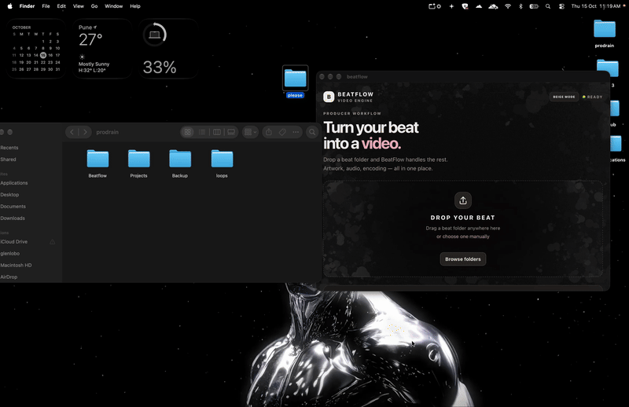

# BeatFlow

**Turn your beat folder into a YouTube-ready music video.**

BeatFlow is a desktop automation tool for music producers. It combines audio and artwork into an MP4 video using FFmpeg, reducing the repetitive work involved in preparing beats for YouTube.

## 🎬 BeatFlow in Action



## macOS Desktop App

The current macOS application is built with Tauri, React, TypeScript, Rust, and FFmpeg.

### Features

- Generate a video from a folder containing an MP3 and its artwork
- Render a 1920 × 1080 MP4 with H.264 video and AAC audio
- Preview the artwork
- Track encoding progress
- Open the output folder after rendering
- Switch between dark and beige themes
- Use drag-and-drop to simplify the workflow

### How to Use

1. Create a folder for your beat.
2. Place the MP3 audio file and its artwork inside that folder.
3. Open BeatFlow and provide the folder through the app's workflow.
4. Start the render and monitor the progress.
5. Open the output folder to access the generated MP4.

**Important:** The input folder must contain both an MP3 file and the artwork. The app is designed around this folder-based workflow.

## Windows Prototype

The `Windows/` directory contains the original Windows Batch prototype, which uses FFmpeg to automate video generation from a beat folder.

The prototype represents the initial version of the project and the workflow that inspired the macOS desktop application.

## Project Structure

```text
BeatFlow-Prototype/
├── Mac/
│   └── BeatFlow/       # macOS desktop application
├── Windows/
│   └── make_video.bat  # Original Windows prototype
├── make_video.bat      # Original root-level prototype script
└── README.md
```

## Technology Stack

- Tauri
- React
- TypeScript
- Rust
- Vite
- FFmpeg

## Development

To run the macOS app in development mode:

```bash
cd Mac/BeatFlow
npm install
npm run tauri dev
```

To build the app:

```bash
npm run tauri build
```

Building requires the appropriate Tauri, Rust, and macOS development prerequisites. FFmpeg must also be available as required by the application.

## Project Status

BeatFlow is an evolving project focused on making music-video preparation more convenient for independent music producers.

## License

No open-source license has been specified yet. All rights are reserved unless a license is added to this repository.
